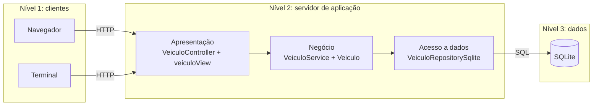

# Garagem de Veículos: cliente-servidor e arquitetura em N camadas

Trabalho prático da disciplina de **Arquitetura de Software**, Universidade de Rio Verde (2026).

**Tema:** Estilo cliente-servidor e arquiteturas em N camadas.

## Integrantes

- Matheus Henrique Bessa Oliveira
- Lucas Ribeiro
- Wander Gabriel
- Elias Vieira

## Descrição

O sistema controla a entrada e a saída de veículos de uma garagem com número limitado de vagas, e calcula o valor a pagar na saída.

Ele mostra na prática os dois estilos estudados no trabalho teórico:

- **Cliente-servidor:** um servidor expõe uma API REST e **dois clientes diferentes** usam o mesmo contrato HTTP. São eles uma página web, que roda no navegador, e um cliente de terminal. Os dois não conhecem nada da implementação interna do servidor.
- **N camadas:** o servidor é dividido em apresentação, negócio e acesso a dados. A dependência desce em um só sentido, e o banco SQLite fica num terceiro nível.

### Como os padrões aparecem no código

| Conceito | Onde está | O que faz |
|---|---|---|
| **MVC** | `servidor/src/apresentacao/` e `negocio/Veiculo.js` | **Model** = entidade `Veiculo` e suas regras. **View** = `veiculoView.js`, que define o JSON devolvido (no cliente web, a tela que o mostra). **Controller** = `VeiculoController.js`, que recebe o HTTP, chama o serviço e escolhe a visão. |
| **Repository** | `negocio/VeiculoRepository.js` (contrato) e `dados/` (implementações) | O serviço grava e busca veículos sem saber que existe SQL. Há duas implementações do mesmo contrato: SQLite e memória. |
| **Injeção de dependência** | `servidor/src/container.js` | Único lugar que cria as classes concretas e as conecta (`repositório → serviço → controller`), por construtor. Trocar o banco é mudar só essa escolha (`DB=memoria`). |
| **Inversão de dependência (SOLID)** | `VeiculoRepository` fica na camada de **negócio** | A camada de dados depende da abstração definida pelo negócio, não o contrário (Figura 4 do trabalho). |

### Regras de negócio

- Placa no formato antigo (`ABC1234`) ou Mercosul (`ABC1D23`). Traços e minúsculas são aceitos e ajustados.
- Modelo (até 40 caracteres) e cor (até 20) são obrigatórios.
- A mesma placa não pode entrar duas vezes sem ter saído.
- A garagem tem limite de vagas (padrão 10).
- Cobrança: **R$ 10,00** pela primeira hora (ou fração) e **R$ 5,00** por hora adicional iniciada.

Erros do domínio viram status HTTP: dado inválido **400**, registro inexistente **404**, regra violada **409**. O corpo da resposta traz a mensagem e, quando houver, o campo que causou o erro, por exemplo `{ "erro": "Informe o modelo do veículo.", "campo": "modelo" }`. O cliente web usa o `campo` para mostrar a mensagem embaixo do campo certo.

## Ferramentas de IA utilizadas

- **Claude Code** (Anthropic, modelo Claude Opus 5.5): ajudou a estruturar o projeto em camadas, escrever o código, os testes automatizados, os diagramas em Mermaid e este README, a partir do trabalho teórico do grupo. O grupo revisou e testou o resultado.

## Requisitos

- **Node.js 22.13 ou mais novo** (testado no 24). Baixe em <https://nodejs.org>. O banco SQLite já vem embutido no Node, então não é preciso instalar banco de dados.

Para conferir a versão:

```bash
node --version
```

## Como executar

```bash
# 1. Baixar o projeto
git clone https://github.com/LcAllmeida/arquiteturaN3.git
cd arquiteturaN3

# 2. Instalar a dependência (Express)
npm install

# 3. Subir o servidor
npm start
```

O terminal mostra `Servidor da garagem em http://localhost:3000`. **Deixe esse terminal aberto**: se ele for fechado, o servidor para e a página deixa de abrir. O banco é criado sozinho em `dados/garagem.db`. Para parar o servidor, use `Ctrl + C`.

### Se a página não abrir

| Sintoma | O que fazer |
|---|---|
| Navegador diz "não é possível acessar esse site" | O servidor não está rodando. Rode `npm start` e deixe o terminal aberto. |
| Terminal diz "A porta 3000 já está em uso" | O servidor já está aberto em outro terminal (use esse), ou outro programa usa a porta: rode em outra porta, ex.: `PORT=3001 npm start` (no PowerShell: `$env:PORT=3001; npm start`) e abra `http://localhost:3001`. |
| Página abre com o aviso "Sem conexão com o servidor" | O servidor foi parado depois que a página abriu. Rode `npm start` e clique em **Tentar novamente**. |
| `npm start` dá erro com `node:sqlite` | O Node está antigo. Instale o Node 22.13 ou mais novo. |

### Cliente 1: navegador

Abra <http://localhost:3000>. Pela página dá para:

- ver a ocupação da garagem (vagas, ocupadas, livres);
- registrar entradas, com validação e mensagem de erro embaixo de cada campo;
- ver os veículos filtrados por **No pátio**, **Histórico** ou **Todos**, com o tempo de permanência e o valor parcial (quanto custaria se saísse agora);
- registrar saídas (mostra o valor a pagar) e remover registros (pede um segundo clique para confirmar).

A lista se atualiza sozinha a cada 15 segundos. A página funciona no computador e no celular.

### Cliente 2: terminal

Com o servidor rodando, abra **outro terminal** na pasta do projeto:

```bash
npm run cli -- entrar ABC1D23 Gol Prata
npm run cli -- entrar XYZ9876 Uno Branco
npm run cli -- listar
npm run cli -- sair 1
npm run cli -- resumo
npm run cli -- remover 1
npm run cli -- entrar QWE4R56 "Fiat Uno" Branco   # modelo com espaço vai entre aspas
npm run cli            # mostra a ajuda
```

O que for feito no terminal aparece na página web (em até 15 segundos, ou na hora com o botão **Atualizar**) e vice-versa, porque os dois clientes usam o mesmo servidor.

### Testes automatizados

```bash
npm test
```

São 13 testes. Os de `VeiculoService.test.js` testam as regras de negócio usando o **repositório em memória** injetado no serviço, sem banco de dados. Os de `api.test.js` sobem o servidor com SQLite e fazem requisições HTTP reais, de ponta a ponta, incluindo os casos de erro (id inválido, JSON inválido, placa repetida, campos longos demais).

### Configurações opcionais

Variáveis de ambiente, todas opcionais:

| Variável | Padrão | Efeito |
|---|---|---|
| `PORT` | `3000` | Porta do servidor |
| `DB` | `dados/garagem.db` | Arquivo do SQLite. Use `memoria` para trocar o repositório pela versão em memória, sem mudar código. |
| `VAGAS` | `10` | Número de vagas da garagem |
| `API_URL` | `http://localhost:3000/api` | Endereço da API usado pelo cliente de terminal |

Exemplo no Linux/macOS: `DB=memoria VAGAS=3 npm start`. No PowerShell: `$env:DB="memoria"; npm start`.

## API REST (contrato entre clientes e servidor)

| Método | Rota | Descrição | Sucesso |
|---|---|---|---|
| GET | `/api/garagem/resumo` | Vagas totais, ocupadas e livres | 200 |
| GET | `/api/veiculos` | Lista todos os veículos (mais recentes primeiro), com `permanenciaMinutos` e, para quem está no pátio, `valorParcial` | 200 |
| GET | `/api/veiculos/:id` | Busca um veículo | 200 |
| POST | `/api/veiculos` | Registra entrada. Corpo: `{ "placa", "modelo", "cor" }` | 201 |
| POST | `/api/veiculos/:id/saida` | Registra saída e calcula o valor | 200 |
| DELETE | `/api/veiculos/:id` | Remove o registro | 204 |

## Estrutura do repositório

```
arquiteturaN3/
├── servidor/
│   ├── src/
│   │   ├── apresentacao/   # camada de apresentação (MVC: controller, view, rotas)
│   │   ├── negocio/        # camada de negócio (entidade, serviço, contrato do repositório)
│   │   ├── dados/          # camada de acesso a dados (repositórios SQLite e memória)
│   │   ├── container.js    # injeção de dependência (monta as camadas)
│   │   └── servidor.js     # ponto de entrada
│   └── test/               # testes automatizados
├── clientes/
│   ├── web/                # cliente 1: página no navegador
│   └── terminal/           # cliente 2: linha de comando
└── docs/diagramas/         # diagramas da solução
```

## Diagramas

Todos estão em [`docs/diagramas`](docs/diagramas/README.md): cliente-servidor, camadas e níveis, sequência de uma requisição, classes do Repository com injeção de dependência e estrutura de pastas.

Resumo das camadas e níveis:


