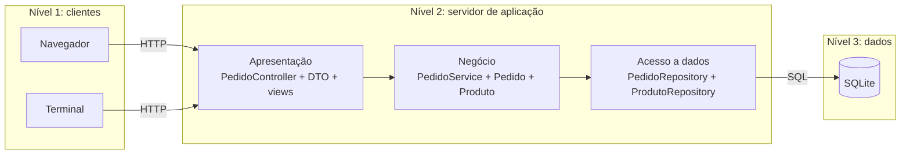

# Loja Virtual de Pedidos: cliente-servidor e arquitetura em N camadas

Trabalho prático da disciplina de **Arquitetura de Software**, Universidade de Rio Verde (2026).

**Tema:** Estilo cliente-servidor e arquiteturas em N camadas.

## Integrantes

- Matheus Henrique Bessa Oliveira
- Lucas Ribeiro
- Wander Gabriel
- Elias Vieira

## Descrição

O sistema implementa a **loja virtual de pedidos em três camadas** descrita como exemplo na seção 6.2 do nosso trabalho teórico. Clientes montam um carrinho com produtos do catálogo e finalizam a compra; o servidor confere o estoque, calcula o total, aplica o desconto e grava o pedido.

Ele mostra na prática os dois estilos estudados:

- **Cliente-servidor:** um servidor expõe uma API REST e **dois clientes diferentes** usam o mesmo contrato HTTP. São eles uma página web, que roda no navegador, e um cliente de terminal, no papel do "aplicativo" do texto. Os dois reutilizam as mesmas regras de negócio, que ficam só no servidor.
- **N camadas:** o servidor é dividido em apresentação, negócio e acesso a dados, e o banco SQLite fica num terceiro nível (Figura 2 do trabalho).

### O fluxo da seção 6.2 no código

| Passo do trabalho (seção 6.2) | Onde acontece |
|---|---|
| a) o cliente envia um `POST` com os itens do carrinho | `clientes/web/app.js` ou `clientes/terminal/cli.js` → `POST /api/pedidos` |
| b) `PedidoController` valida o formato, converte em objeto de transferência e aciona o serviço | `servidor/src/apresentacao/PedidoController.js` e `pedidoDTO.js` |
| c) `PedidoService` verifica o estoque, calcula o total, aplica o desconto e coordena a operação | `servidor/src/negocio/PedidoService.js`, `Pedido.js`, `Produto.js` |
| d) `PedidoRepository` e `ProdutoRepository` gravam o pedido e atualizam o estoque **numa única transação** | `servidor/src/dados/` (`TransacaoSqlite` faz `BEGIN`/`COMMIT`/`ROLLBACK`) |
| e) o servidor devolve uma resposta HTTP com o número do pedido | `201 Created` com o pedido e o cabeçalho `Location: /api/pedidos/<número>` |

### Como os padrões aparecem no código

| Conceito | Onde está | O que faz |
|---|---|---|
| **MVC** | `servidor/src/apresentacao/` e `negocio/` | **Model** = entidades `Pedido` e `Produto` com suas regras. **View** = `views.js`, que define o JSON devolvido (no cliente web, a tela que o mostra). **Controller** = `PedidoController` e `ProdutoController`, que recebem o HTTP, chamam o serviço e escolhem a visão. |
| **Repository** | `negocio/contratos.js` (contratos) e `dados/` (implementações) | O serviço grava e busca pedidos e produtos sem saber que existe SQL. Cada contrato tem duas implementações: SQLite e memória. |
| **Injeção de dependência** | `servidor/src/container.js` | Único lugar que cria as classes concretas e as conecta por construtor (`repositórios + transação → serviços → controllers`). Trocar o banco é mudar só essa escolha (`DB=memoria`). |
| **Inversão de dependência (SOLID)** | os contratos ficam na camada de **negócio** | A camada de dados depende das abstrações definidas pelo negócio, não o contrário (Figura 4 do trabalho: `PedidoService → «interface» PedidoRepository ← PedidoRepositorySqlite`). |
| **DTO** | `apresentacao/pedidoDTO.js` | Valida e converte o JSON recebido num objeto simples. O preço enviado pelo cliente é ignorado: vale sempre o do catálogo do servidor. |
| **Architecture sinkhole** | `negocio/ProdutoService.js` | A consulta ao catálogo atravessa o serviço sem regra nenhuma, como discutido no fim da seção 6.2. Mantivemos a camada fechada para preservar o isolamento; o comentário no arquivo explica a escolha. |

### Regras de negócio

- O nome do cliente é obrigatório (de 2 a 60 caracteres).
- O pedido tem de 1 a 20 produtos diferentes, com quantidade inteira de 1 a 99 cada. O mesmo produto repetido vira uma linha só.
- Só é possível comprar o que há em estoque. Se faltar um item, **nada** é gravado: a transação desfaz a baixa dos outros itens.
- **Desconto de 10%** em pedidos a partir de **R$ 300,00**.
- Cancelar um pedido devolve os itens ao estoque. Um pedido cancelado não pode ser cancelado de novo.
- Os valores são guardados em centavos (inteiros), para não haver erro de arredondamento.

Erros viram status HTTP: formato inválido **400**, pedido inexistente **404**, regra violada (ex.: estoque insuficiente) **409**. O corpo traz a mensagem e, quando houver, o campo que causou o erro, por exemplo `{ "erro": "Informe o nome do cliente (pelo menos 2 letras).", "campo": "cliente" }`. O cliente web usa o `campo` para mostrar a mensagem no lugar certo.

## Ferramentas de IA utilizadas

- **Claude Code** (Anthropic, modelo Claude Opus 5.5): ajudou a estruturar o projeto em camadas, escrever o código, os testes automatizados, os diagramas em Mermaid e este README, a partir do trabalho teórico do grupo. O grupo revisou e testou o resultado.

## Requisitos

- **Node.js 22.13 ou mais novo** (testado no 24). Baixe em <https://nodejs.org>. O banco SQLite já vem embutido no Node, então não é preciso instalar banco de dados.

Para conferir a versão:

```bash
node --version
```

## Como executar

```bash
# 1. Baixar o projeto
git clone https://github.com/LcAllmeida/arquiteturaN3.git
cd arquiteturaN3

# 2. Instalar a dependência (Express)
npm install

# 3. Subir o servidor
npm start
```

O terminal mostra `Servidor da loja em http://localhost:3000`. **Deixe esse terminal aberto**: se ele for fechado, o servidor para e a página deixa de abrir. O banco é criado sozinho em `dados/loja.db`, já com 6 produtos no catálogo. Para parar o servidor, use `Ctrl + C`.

Para voltar o estoque e apagar os pedidos (com o servidor parado):

```bash
npm run reset
```

### Se a página não abrir

| Sintoma | O que fazer |
|---|---|
| Navegador diz "não é possível acessar esse site" | O servidor não está rodando. Rode `npm start` e deixe o terminal aberto. |
| Terminal diz "A porta 3000 já está em uso" | O servidor já está aberto em outro terminal (use esse), ou outro programa usa a porta: rode em outra porta, ex.: `PORT=3001 npm start` (no PowerShell: `$env:PORT=3001; npm start`) e abra `http://localhost:3001`. |
| Página abre com o aviso "Sem conexão com o servidor" | O servidor foi parado depois que a página abriu. Rode `npm start` e clique em **Tentar novamente**. |
| `npm start` dá erro com `node:sqlite` | O Node está antigo. Instale o Node 22.13 ou mais novo. |

### Cliente 1: navegador

Abra <http://localhost:3000>. Pela página dá para:

- ver o resumo da loja (pedidos confirmados, itens vendidos, faturamento);
- ver o catálogo com preço e estoque, e adicionar produtos ao carrinho (o carrinho não deixa passar do estoque);
- ajustar quantidades no carrinho e ver subtotal, desconto e total antes de finalizar;
- finalizar o pedido informando o nome do cliente;
- ver os pedidos filtrados por **Confirmados**, **Cancelados** ou **Todos**, e cancelar um pedido (pede um segundo clique para confirmar).

A página se atualiza sozinha a cada 15 segundos e funciona no computador e no celular.

### Cliente 2: terminal

Com o servidor rodando, abra **outro terminal** na pasta do projeto:

```bash
npm run cli -- produtos                        # catálogo com id, preço e estoque
npm run cli -- comprar "Ana Souza" 1:1 2:2     # cliente e itens no formato <id>:<quantidade>
npm run cli -- pedidos
npm run cli -- cancelar 1
npm run cli -- resumo
npm run cli                                    # mostra a ajuda
```

O que for feito no terminal aparece na página web (em até 15 segundos, ou na hora com o botão **Atualizar**) e vice-versa, porque os dois clientes usam o mesmo servidor. Dá para ver o servidor como árbitro: ponha 5 monitores no carrinho da página, compre 3 pelo terminal e tente finalizar na página. O servidor recusa e a página mostra quanto restou em estoque.

### Testes automatizados

```bash
npm test
```

São 13 testes:

- `PedidoService.test.js`: regras de negócio usando os **repositórios em memória** injetados no serviço, sem banco de dados (estoque, desconto, cancelamento, resumo). Inclui um teste em que gravar o pedido falha de propósito no **SQLite real**, para provar que a transação desfaz a baixa de estoque.
- `api.test.js`: sobe o servidor com SQLite e faz requisições HTTP reais, de ponta a ponta, incluindo os casos de erro.

### Configurações opcionais

| Variável | Padrão | Efeito |
|---|---|---|
| `PORT` | `3000` | Porta do servidor |
| `DB` | `dados/loja.db` | Arquivo do SQLite. Use `memoria` para trocar os repositórios pela versão em memória, sem mudar código. |
| `API_URL` | `http://localhost:3000/api` | Endereço da API usado pelo cliente de terminal |

Exemplo no Linux/macOS: `DB=memoria npm start`. No PowerShell: `$env:DB="memoria"; npm start`.

## API REST (contrato entre clientes e servidor)

| Método | Rota | Descrição | Sucesso |
|---|---|---|---|
| GET | `/api/produtos` | Catálogo com preço e estoque | 200 |
| POST | `/api/pedidos` | Finaliza a compra. Corpo: `{ "cliente": "Ana", "itens": [{ "produtoId": 1, "quantidade": 2 }] }` | 201 |
| GET | `/api/pedidos` | Lista os pedidos (mais recentes primeiro) | 200 |
| GET | `/api/pedidos/:id` | Busca um pedido | 200 |
| POST | `/api/pedidos/:id/cancelamento` | Cancela o pedido e devolve o estoque | 200 |
| GET | `/api/loja/resumo` | Pedidos confirmados, itens vendidos, faturamento e regra de desconto | 200 |

## Estrutura do repositório

```
arquiteturaN3/
├── servidor/
│   ├── src/
│   │   ├── apresentacao/   # camada de apresentação (MVC: controllers, views, DTO, rotas)
│   │   ├── negocio/        # camada de negócio (entidades, serviços, contratos dos repositórios)
│   │   ├── dados/          # camada de acesso a dados (SQLite, memória, transação, catálogo inicial)
│   │   ├── container.js    # injeção de dependência (monta as camadas)
│   │   └── servidor.js     # ponto de entrada
│   └── test/               # testes automatizados
├── clientes/
│   ├── web/                # cliente 1: página no navegador
│   └── terminal/           # cliente 2: linha de comando
└── docs/diagramas/         # diagramas da solução
```

## Diagramas

Todos estão em [`docs/diagramas`](docs/diagramas/README.md): cliente-servidor, camadas e níveis, sequência da finalização de compra (Figura 3 do trabalho), classes com Repository e injeção de dependência (Figura 4) e estrutura de pastas.

Resumo das camadas e níveis:


