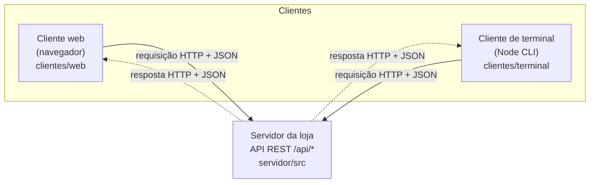
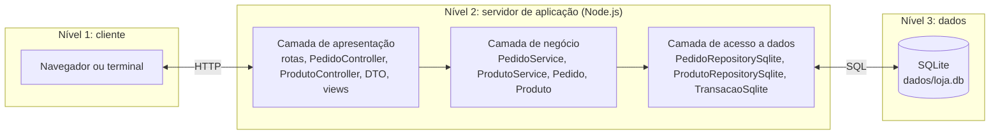
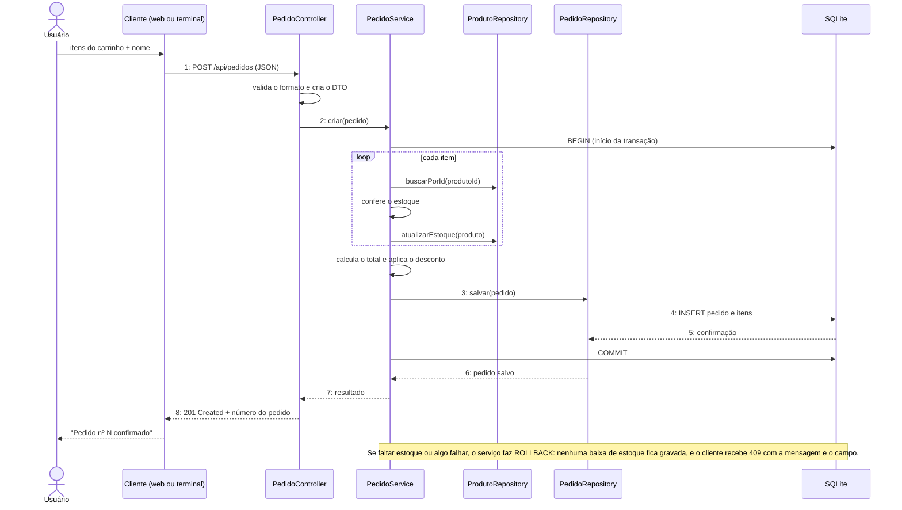
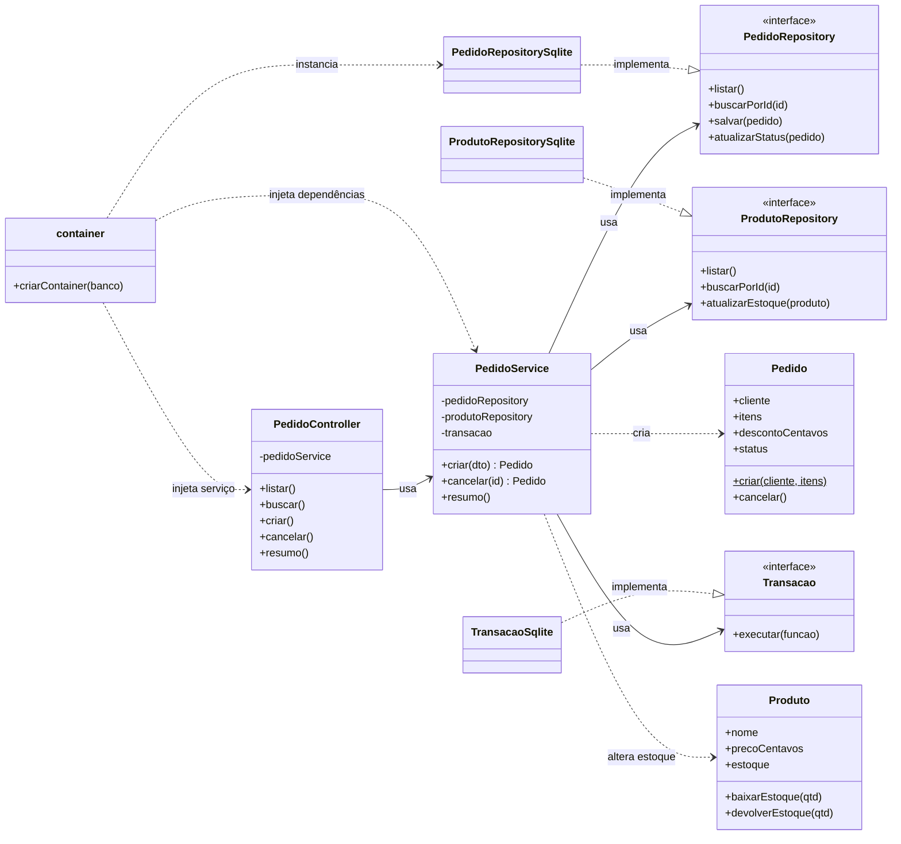
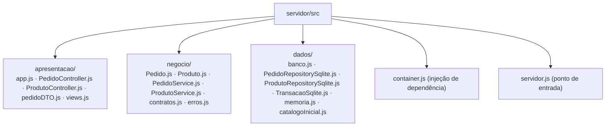

# Diagramas da solução

Os diagramas estão em Mermaid, que o GitHub desenha direto na página. Eles seguem as Figuras 1 a 4 do trabalho teórico, aplicadas à loja virtual de pedidos da seção 6.2.

1. [Cliente-servidor](#1-cliente-servidor)
2. [Camadas lógicas e níveis físicos](#2-camadas-lógicas-e-níveis-físicos)
3. [Sequência: finalizar a compra](#3-sequência-finalizar-a-compra-post-apipedidos)
4. [Classes: Repository e injeção de dependência](#4-classes-repository-e-injeção-de-dependência)
5. [Estrutura de pastas por camada](#5-estrutura-de-pastas-por-camada)

## 1. Cliente-servidor

Dois clientes diferentes falam com o mesmo servidor, pelo mesmo contrato (API REST sobre HTTP). Os dois reutilizam as mesmas regras de negócio, que ficam no servidor.

## 2. Camadas lógicas e níveis físicos

As caixas internas são **camadas** (organização do código). Os blocos externos são **níveis** (onde cada parte executa). A dependência entre camadas desce em um só sentido.

## 3. Sequência: finalizar a compra (`POST /api/pedidos`)

Mesmo fluxo da Figura 3 do trabalho, com os passos de 1 a 8. Cada camada faz só a parte que lhe cabe.

## 4. Classes: Repository e injeção de dependência

Mesma ideia da Figura 4 do trabalho. `PedidoService` depende só das abstrações (`PedidoRepository`, `ProdutoRepository` e `Transacao`), que ficam na camada de negócio. As implementações ficam na camada de dados. O `container` é o único ponto que escolhe as classes concretas e as injeta pelo construtor.

As versões em memória (`PedidoRepositoryMemoria`, `ProdutoRepositoryMemoria`, `TransacaoMemoria`, em `dados/memoria.js`) implementam os mesmos três contratos. Elas são usadas nos testes e com `DB=memoria`.

## 5. Estrutura de pastas por camada

