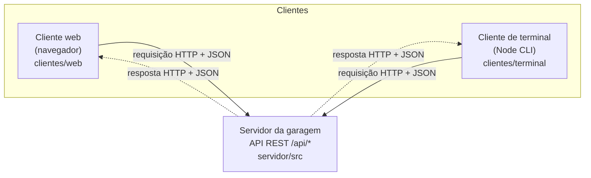
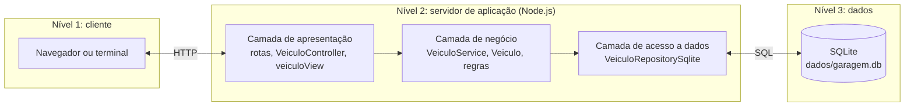
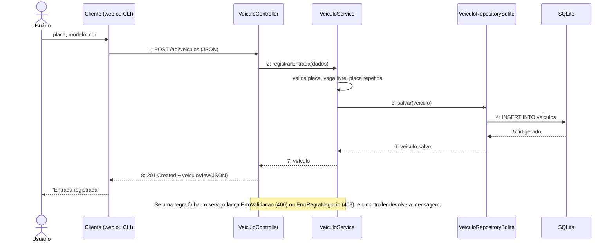
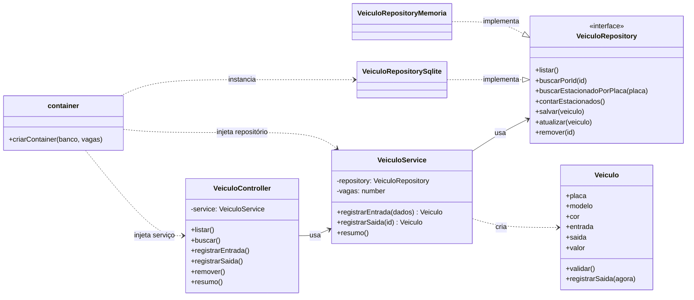
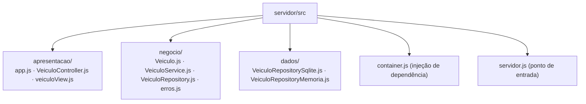

# Diagramas da solução

Os diagramas estão em Mermaid, que o GitHub desenha direto na página. Eles seguem as Figuras 1 a 4 do trabalho teórico, aplicadas à Garagem de Veículos.

1. [Cliente-servidor](#1-cliente-servidor)
2. [Camadas lógicas e níveis físicos](#2-camadas-lógicas-e-níveis-físicos)
3. [Sequência: registrar entrada](#3-sequência-registrar-entrada-post-apiveiculos)
4. [Classes: Repository e injeção de dependência](#4-classes-repository-e-injeção-de-dependência)
5. [Estrutura de pastas por camada](#5-estrutura-de-pastas-por-camada)

## 1. Cliente-servidor

Dois clientes diferentes falam com o mesmo servidor, pelo mesmo contrato (API REST sobre HTTP). Nenhum dos dois conhece a implementação interna do servidor.

## 2. Camadas lógicas e níveis físicos

As caixas internas são **camadas** (organização do código). Os blocos externos são **níveis** (onde cada parte executa). A dependência entre camadas desce em um só sentido.

## 3. Sequência: registrar entrada (`POST /api/veiculos`)

Cada camada faz só a parte que lhe cabe: o controller traduz HTTP, o serviço aplica as regras e o repositório grava.

## 4. Classes: Repository e injeção de dependência

`VeiculoService` depende só da abstração `VeiculoRepository`, que fica na camada de negócio. As duas implementações ficam na camada de dados. O `container` é o único ponto que escolhe a classe concreta e a injeta pelo construtor.

## 5. Estrutura de pastas por camada

